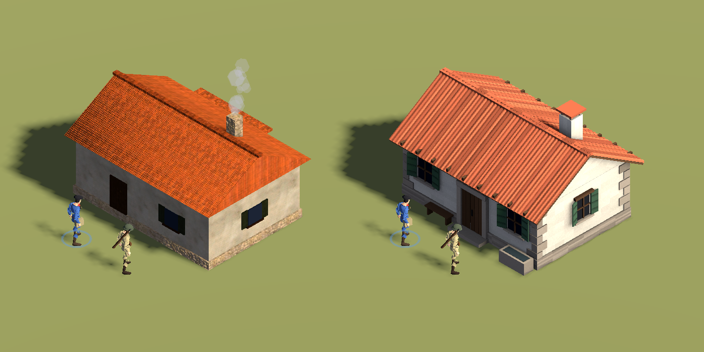
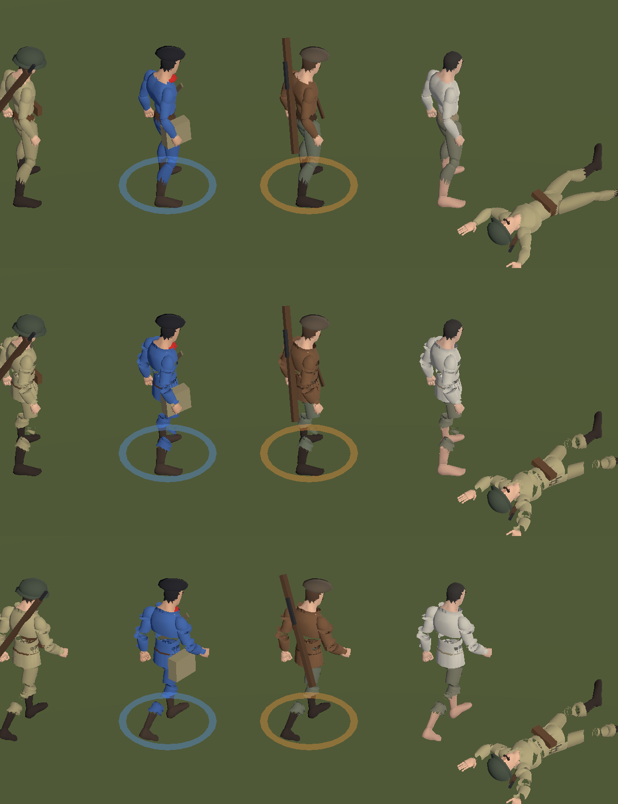

# Blender trial

A trial of making the game's models in Blender, driven by Python scripts, to see whether it
brings the look closer to hand-made art. Nothing here is used by the game yet.

- `tools/blender/farmhouse.py` builds a farmhouse as one mesh: plaster walls on a stone plinth,
  quoins, a door in a stone surround, shuttered windows, rafter ends, a barrel-tile roof and a
  chimney. Colours are on the vertices; ambient occlusion is baked to a texture.
  `blender -b -P tools/blender/farmhouse.py -- assets/buildings/farmhouse.glb`
- `tools/blender/soldier.py` lifts the jacket and trousers of the soldier off the body as cloth
  shells, with a skirt, collar and cuffs, keeping skin weights, texture coordinates and all
  thirteen animations.
  `blender -b -P tools/blender/soldier.py -- assets/characters/soldier/soldier.glb out.glb`
- `tools/model_preview.gd` renders the code-built building beside a model file from the game's
  camera.

Left, the building the game builds in code; right, the Blender model.

Top, the units today; middle and bottom, dressed by the script, standing and walking. The
animations and the uniform palettes survive the round trip through Blender. The cloth is rough:
the mannequin is made of separate pieces at every joint, so each piece gets its own ragged rim.

## What it shows

- Buildings: a clear gain for little work. To use one in the game it needs what `Building` gives
  the code-built ones: collision, a navmesh cut-out, and for enterable buildings a roof that
  lifts and walls that are cut down while a room is looked into.
- Soldiers: the pipeline works, but clothing generated over this mannequin does not look good
  enough. Better soldiers need a better base model, or clothes modelled by hand.
